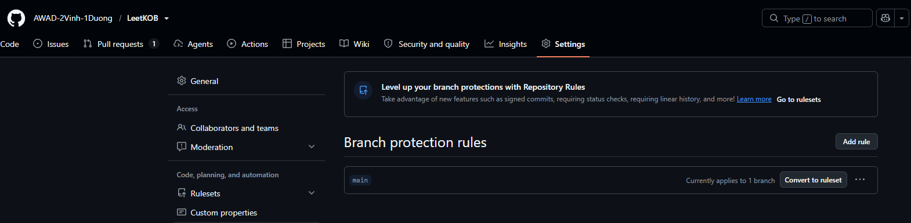
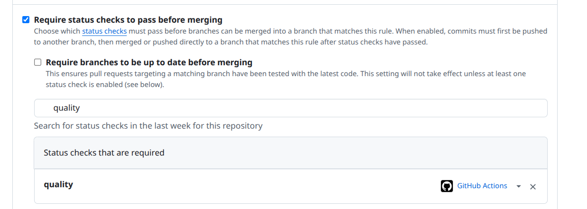
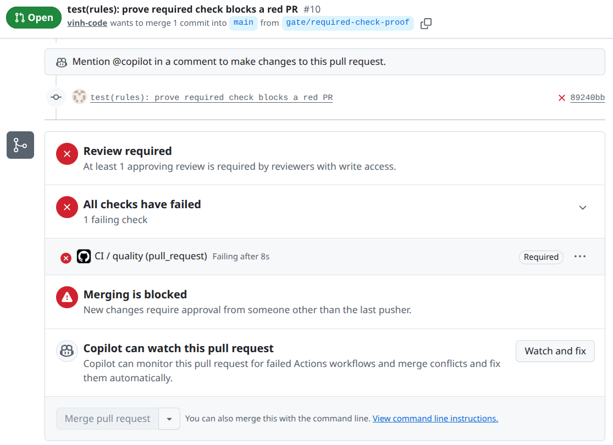

# PA2 Submission

- Public Repository link: https://github.com/AWAD-2Vinh-1Duong/LeetKOB
- Branch protection: 
- Required status check `quality` (bắt buộc CI xanh mới được merge vào `main`): 
- Pull request bị check bắt buộc `quality` chặn rồi chuyển xanh (sau khi bật required check): https://github.com/AWAD-2Vinh-1Duong/LeetKOB/pull/10
  - Commit cố tình vi phạm lint: https://github.com/AWAD-2Vinh-1Duong/LeetKOB/pull/10/commits/89240bbab73f687b5b211216b7121fe1d27d9f5c
  - CI run đỏ: https://github.com/AWAD-2Vinh-1Duong/LeetKOB/actions/runs/42460328414
  - Merge bị chặn (`quality` hiện **Required**, nút Merge bị khoá): 
  - Commit làm PR xanh trở lại: https://github.com/AWAD-2Vinh-1Duong/LeetKOB/pull/10/commits/5fe2fb214e69f2bd626994e01d87f2732c9c4fc2
  - CI run xanh: https://github.com/AWAD-2Vinh-1Duong/LeetKOB/actions/runs/42460493989
- Pull request đầu tiên bị CI đỏ rồi chuyển xanh (31/10, trước khi `quality` thành check bắt buộc): https://github.com/AWAD-2Vinh-1Duong/LeetKOB/pull/6
  - Commit cố tình vi phạm lint: https://github.com/AWAD-2Vinh-1Duong/LeetKOB/pull/6/commits/8f8f01a2608d067000f38ec0b44cf0e054e994ab
  - CI run đỏ: https://github.com/AWAD-2Vinh-1Duong/LeetKOB/actions/runs/41222159341
  - Commit làm PR xanh trở lại: https://github.com/AWAD-2Vinh-1Duong/LeetKOB/pull/6/commits/e04ff6f349e07bf7cfe1b6658e7caabfc289cc1e
  - CI run xanh: https://github.com/AWAD-2Vinh-1Duong/LeetKOB/actions/runs/41222245456
- CI run cho tag `pa2`: https://github.com/AWAD-2Vinh-1Duong/LeetKOB/actions?query=branch%3Apa2 (run trên cùng là run của commit đang gắn tag; file này nằm trong chính commit đó nên không thể ghi sẵn số run)
- Deliberate contract break (PR): https://github.com/AWAD-2Vinh-1Duong/LeetKOB/pull/8
  - Commit vi phạm contract (bỏ idempotency lookup): https://github.com/AWAD-2Vinh-1Duong/LeetKOB/pull/8/commits/fb6e601019dee79c7a768e11c19a6fb030114ba6
  - CI run đỏ (3 test idempotency fail): https://github.com/AWAD-2Vinh-1Duong/LeetKOB/actions/runs/41383050327
  - Commit sửa lại cho đúng contract (không sửa test): https://github.com/AWAD-2Vinh-1Duong/LeetKOB/pull/8/commits/d7d4c9211c4e34fa82f98f56db49aa58c70833fd
  - CI run xanh trở lại: https://github.com/AWAD-2Vinh-1Duong/LeetKOB/actions/runs/41383117774
