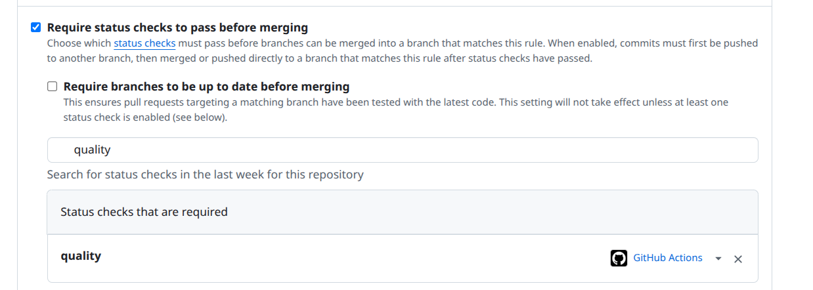
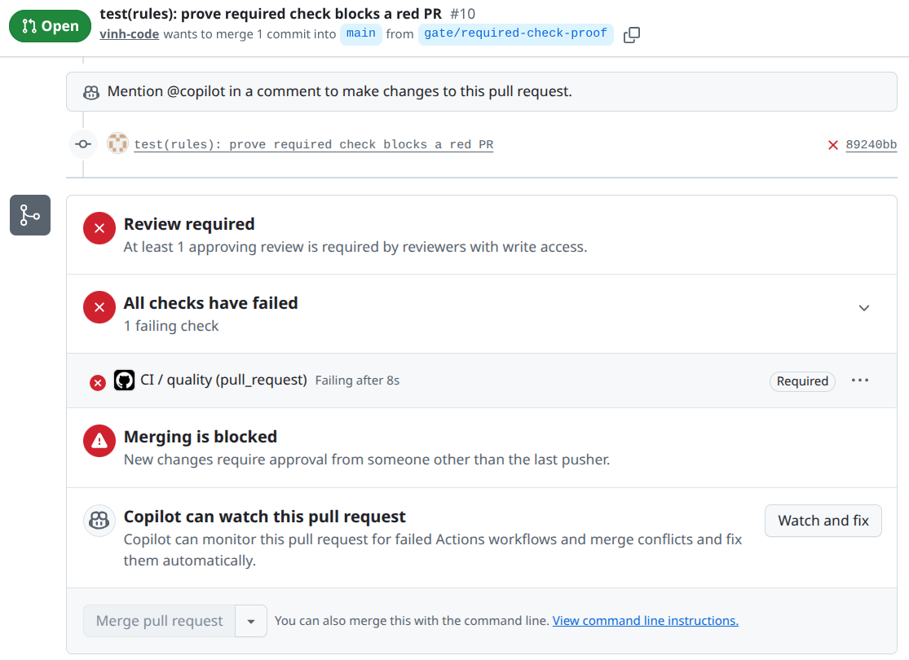

# Self-assessment — PA#2: Harness and quality gate

Submitted by: team 2Vinh-1Duong  
23120190 — Nguyễn Lê Thế Vinh  
23120202 — Phạm Quang Vinh  
23120242 — Nguyễn Văn Bình Dương  
Total I claim: 98 / 100

| Criterion                            |     Max | I claim | Evidence                                                                                                                                                                                                                                                                                                                                                                                                                                                                                                                                                                                                                                                                                                                                                                                                                                                                                                                                                                                                                                                                                                                                                                                                                                                                                                                                                                                                                                                                                                                                                                                                                                                                                                                                                                                                                            |
| ------------------------------------ | ------: | ------: | ----------------------------------------------------------------------------------------------------------------------------------------------------------------------------------------------------------------------------------------------------------------------------------------------------------------------------------------------------------------------------------------------------------------------------------------------------------------------------------------------------------------------------------------------------------------------------------------------------------------------------------------------------------------------------------------------------------------------------------------------------------------------------------------------------------------------------------------------------------------------------------------------------------------------------------------------------------------------------------------------------------------------------------------------------------------------------------------------------------------------------------------------------------------------------------------------------------------------------------------------------------------------------------------------------------------------------------------------------------------------------------------------------------------------------------------------------------------------------------------------------------------------------------------------------------------------------------------------------------------------------------------------------------------------------------------------------------------------------------------------------------------------------------------------------------------------------------- |
| Rules file                           |      15 |      14 | [AGENTS.md](AGENTS.md) has the required sections and product-specific rules. Lessons reference [commit cfcb089](https://github.com/AWAD-2Vinh-1Duong/LeetKOB/commit/cfcb089) and [AI-LOG.md](AI-LOG.md); Two [AGENTS.md](AGENTS.md) lines trace to real incidents: _Deliberate Breaks_ (lint error that landed on `main` in commit `cfcb089`) and _Verify Claims_ (the 2026-10-30 AI-LOG entry claimed a `ci.yml` that was empty). [CLAUDE.md](CLAUDE.md) adds five more lessons, including the first `CLAUDE.md` failing `prettier --check`. Every command listed exists in [package.json](package.json); stack items not installed yet are marked _(PA#3)_.                                                                                                                                                                                                                                                                                                                                                                                                                                                                                                                                                                                                                                                                                                                                                                                                                                                                                                                                                                                                                                                                                                                                                                       |
| Permissions and secrets              |      10 |       9 | [AGENTS.md](AGENTS.md), [.env.example](.env.example), and [.gitignore](.gitignore) document permissions and secret handling. [README.md](README.md) states the spending cap: 0 USD, enforced by the provider because the key's project has no billing account (requests over the Free-tier quota get `429`, never a charge), and the model `gemini-3.6-flash`; the [dashboard screenshot](docs/tasks/PA2/assets/provider-dashboard.png) shows Free tier. The group reports that Google AI Studio requires an 800,000 VND prepayment to enable billing. `gitleaks detect --log-opts="--all"` finds no leaks in the history; the one false positive (an example `Idempotency-Key` in the contract) is listed in [.gitleaksignore](.gitleaksignore).                                                                                                                                                                                                                                                                                                                                                                                                                                                                                                                                                                                                                                                                                                                                                                                                                                                                                                                                                                                                                                                                                   |
| One command for every check          |      10 |      10 | [package.json](package.json) defines `npm run check`; [.github/workflows/ci.yml](.github/workflows/ci.yml) runs `npm ci` and `npm run check`; [README.md](README.md) documents the same commands.                                                                                                                                                                                                                                                                                                                                                                                                                                                                                                                                                                                                                                                                                                                                                                                                                                                                                                                                                                                                                                                                                                                                                                                                                                                                                                                                                                                                                                                                                                                                                                                                                                   |
| CI that blocks a merge               |      20 |      20 | [PA2.md](PA2.md) links PR [#10](https://github.com/AWAD-2Vinh-1Duong/LeetKOB/pull/10), opened after `quality` became a required check: lint-breaking commit [89240bb](https://github.com/AWAD-2Vinh-1Duong/LeetKOB/pull/10/commits/89240bbab73f687b5b211216b7121fe1d27d9f5c) with failed run [42460328414](https://github.com/AWAD-2Vinh-1Duong/LeetKOB/actions/runs/42460328414) left the merge blocked ([screenshot](docs/tasks/PA2/assets/required-check-blocks-merge.png)), then fix commit [5fe2fb2](https://github.com/AWAD-2Vinh-1Duong/LeetKOB/pull/10/commits/5fe2fb214e69f2bd626994e01d87f2732c9c4fc2) with green run [42460493989](https://github.com/AWAD-2Vinh-1Duong/LeetKOB/actions/runs/42460493989). The earlier PR [#6](https://github.com/AWAD-2Vinh-1Duong/LeetKOB/pull/6) went red and green the same way before the check was required: lint-breaking commit [8f8f01a](https://github.com/AWAD-2Vinh-1Duong/LeetKOB/pull/6/commits/8f8f01a2608d067000f38ec0b44cf0e054e994ab) with failed run [41222159341](https://github.com/AWAD-2Vinh-1Duong/LeetKOB/actions/runs/41222159341), then fix commit [e04ff6f](https://github.com/AWAD-2Vinh-1Duong/LeetKOB/pull/6/commits/e04ff6f349e07bf7cfe1b6658e7caabfc289cc1e) with green run [41222245456](https://github.com/AWAD-2Vinh-1Duong/LeetKOB/actions/runs/41222245456); tag runs are listed at [actions?query=branch:pa2](https://github.com/AWAD-2Vinh-1Duong/LeetKOB/actions?query=branch%3Apa2). The [branch-protection screenshot](docs/tasks/PA2/assets/branch-protection.png) and [Do not allow bypass screenshot](docs/tasks/PA2/assets/do-not-bypass.png) show the rule on `main`; the [required-status-check screenshot](docs/tasks/PA2/assets/required-status-check.png) shows the CI job `quality` listed under "Status checks that are required". |
| The contract of one LeeTKOB endpoint |      25 |      25 | [POST /labs/{labId}/submissions contract](docs/contract/post-labs-submissions.md), sections 1–7, specifies role, ownership, request/response, RFC 9457 errors, idempotency, side effects, and change policy.                                                                                                                                                                                                                                                                                                                                                                                                                                                                                                                                                                                                                                                                                                                                                                                                                                                                                                                                                                                                                                                                                                                                                                                                                                                                                                                                                                                                                                                                                                                                                                                                                        |
| Contract tests that bite             |      15 |      15 | [Contract tests](tests/contract/post-labs-submissions.test.js) check RFC 9457 bodies, roles, ownership, validation, deadline, and idempotency. PR [#8](https://github.com/AWAD-2Vinh-1Duong/LeetKOB/pull/8) includes failing run [41383050327](https://github.com/AWAD-2Vinh-1Duong/LeetKOB/actions/runs/41383050327), fix commit [d7d4c921](https://github.com/AWAD-2Vinh-1Duong/LeetKOB/pull/8/commits/d7d4c9211c4e34fa82f98f56db49aa58c70833fd), and green run [41383117774](https://github.com/AWAD-2Vinh-1Duong/LeetKOB/actions/runs/41383117774). Every error type in the contract has a test, including `500 internal-error`, which also checks that no secret, raw error message or stack trace reaches the response.                                                                                                                                                                                                                                                                                                                                                                                                                                                                                                                                                                                                                                                                                                                                                                                                                                                                                                                                                                                                                                                                                                       |
| AI-LOG.md                            |       5 |       5 | [AI-LOG.md](AI-LOG.md) contains substantive `Changed`/`Rejected` entries for the 2026-10-31 AGENTS review, the 2026-10-31 Claude Code session that set up `CLAUDE.md` and the check tooling, and the 2026-10-30 CI setup.                                                                                                                                                                                                                                                                                                                                                                                                                                                                                                                                                                                                                                                                                                                                                                                                                                                                                                                                                                                                                                                                                                                                                                                                                                                                                                                                                                                                                                                                                                                                                                                                           |
| **Total**                            | **100** |  **98** |                                                                                                                                                                                                                                                                                                                                                                                                                                                                                                                                                                                                                                                                                                                                                                                                                                                                                                                                                                                                                                                                                                                                                                                                                                                                                                                                                                                                                                                                                                                                                                                                                                                                                                                                                                                                                                     |

## Branch protection evidence (criterion 4)

`main` requires a pull request with one approval, does not allow bypassing, and requires the CI job `quality` to pass before merging:

PR #10 with the deliberate lint error: `quality` is marked **Required**, it failed, and merging is blocked:

## What I did not manage

- Configure a provider-side spending cap. Google AI Studio requires an 800,000 VND prepayment to enable billing, so the team chose to stay on Free tier; the dashboard screenshot shows the Free-tier status.

## What I would do differently

Collect primary evidence as each requirement is completed, then reconcile the checklist, proof reports, and PA2.md before calculating the self-score and naming the submission archive.

The total in this table must match the total in the submission file name: `23120190-23120202-23120242_98.zip`.
